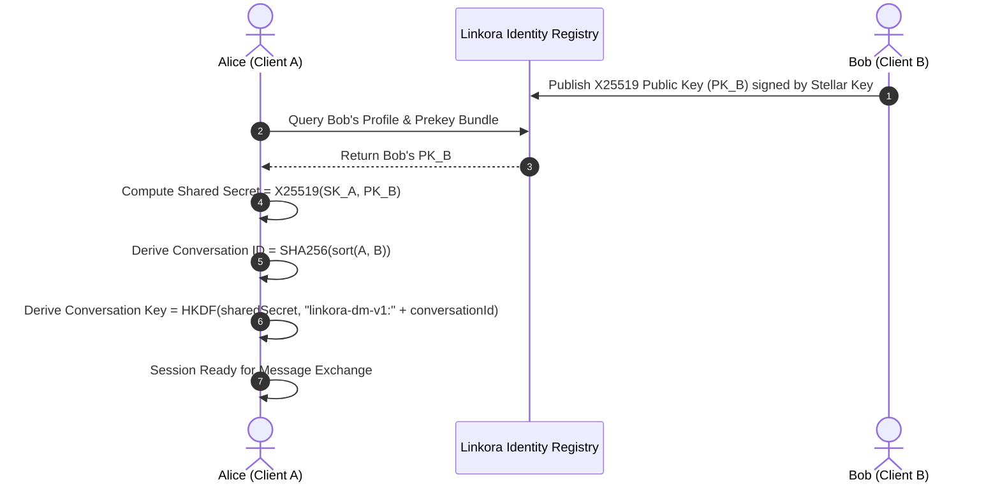
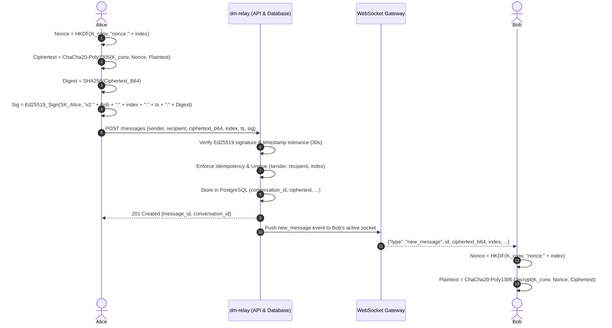

# Linkora Direct Message Relay Protocol Specification (`v1` / `v2` Auth)

**Status:** Active Specification  
**Version:** 1.0.0  
**Scope:** `services/dm-relay`, `@linkora/sdk/dm`, `@linkora/types`  
**Reference Issue:** #1719 (Resolves #1719)  

---

## 1. Executive Summary & Context

`services/dm-relay` is a lightweight, high-performance messaging relay service enabling end-to-end encrypted (E2EE) communications between Stellar accounts on the Linkora network. The service facilitates direct messages (DMs) while adhering to zero-knowledge server semantics: **relay operators and network observers never obtain plaintext access to message content, session keys, or decryption material.**

This document formally specifies:
1. The cryptographic primitives and key agreement flows.
2. The deterministic session establishment and conversation addressing model.
3. Message wire formats, schema representations, and HTTP/WebSocket endpoints.
4. Delivery receipts and read-marker semantics.
5. Multi-party and group DM routing architectures.
6. The comprehensive threat model and security considerations.
7. Sequence diagrams for session initialization, transmission, and delivery.

---

## 2. Cryptographic Architecture & Primitives

Linkora DM relay explicitly decouples account identity (Stellar SEP-0023 signing keys) from encryption keys to preserve forward hygiene and support independent key lifecycles.

| Primitive | Standard / RFC | Role & Purpose | Key / Block Size |
| :--- | :--- | :--- | :--- |
| **X25519** | RFC 7748 | Ephemeral and prekey Diffie-Hellman key agreement | 32-byte public / private keys |
| **ChaCha20-Poly1305** | RFC 8439 | Authenticated Encryption with Associated Data (AEAD) | 256-bit key, 96-bit (12-byte) nonce, 128-bit tag |
| **HKDF-SHA256** | RFC 5869 | Key derivation for conversation keys and per-message nonces | Extract-and-Expand with SHA-256 |
| **Ed25519** | RFC 8032 | Stellar account identity signatures and request attestation | 32-byte public key (G...), 64-byte signature |
| **SHA-256** | FIPS 180-4 | Deterministic conversation hashing and ciphertext binding | 32-byte output digest (hex-encoded) |

---

## 3. Key Exchange & Session Setup

### 3.1 Keypair Generation
Each participant generates an X25519 keypair specifically for direct messaging (`DmKeyPair`):
```typescript
interface DmKeyPair {
  publicKey: Uint8Array;  // 32 bytes Curve25519 public key
  privateKey: Uint8Array; // 32 bytes Curve25519 secret scalar
}
```
*Note:* DM private keys must be stored in secure local storage (e.g. encrypted IndexedDB, keychain, or hardware enclave) and never transmitted to relays or indexing nodes.

### 3.2 Prekey Bundle Publication
Users register their public X25519 identity key alongside their Stellar account public key (`G...`) through the Linkora Profile registry contract or profile metadata endpoint:
```json
{
  "stellar_address": "GBBD...5678",
  "dm_public_key_hex": "a3f7...b942",
  "created_at": 1729320000,
  "signature": "84e1..."
}
```

### 3.3 Shared Secret Agreement
When Alice (`A`) wishes to communicate with Bob (`B`), Alice retrieves Bob's published X25519 public key `PK_B`. Alice utilizes her private key `SK_A`:
```text
sharedSecret = X25519(SK_A, PK_B) = X25519(SK_B, PK_A)
```

### 3.4 Deterministic Conversation ID
To eliminate central conversation coordinators and prevent routing race conditions, the conversation ID is derived deterministically from the participants' Stellar addresses using canonical lexicographical sorting:
```text
sorted = sort([addressA, addressB])
conversationId = SHA-256(sorted[0] + sorted[1]).hex
```

Implementation reference (`packages/sdk/src/dm/crypto.ts`):
```typescript
export function createConversationId(addressA: string, addressB: string): string {
  const sorted = [addressA, addressB].sort();
  const combined = sorted[0] + sorted[1];
  return Buffer.from(sha256(new TextEncoder().encode(combined))).toString('hex');
}
```

### 3.5 Conversation Key Derivation
The symmetric encryption key `conversationKey` is derived via HKDF-Expand with domain separation:
```text
conversationKey = HKDF-Expand(PRK = sharedSecret, info = "linkora-dm-v1:" + conversationId, length = 32)
```

### 3.6 Deterministic Nonce Derivation
To prevent nonce-reuse catastrophes in ChaCha20-Poly1305 without transmitting extra random state over the wire, each message derives a deterministic 12-byte nonce from the conversation key and the message sequence index:
```text
nonce = HKDF-Expand(PRK = conversationKey, info = "nonce:" + messageIndex, length = 12)
```

Because each `(conversationKey, messageIndex)` pair produces an authentic, unique nonce, nonces are never repeated across a conversation.

---

## 4. Message Envelope & Wire Format

### 4.1 JSON Envelope Schema
When submitting a direct message to `POST /messages`, the client provides a signed envelope conforming to the schema below:

```json
{
  "$schema": "http://json-schema.org/draft-07/schema#",
  "title": "SendMessageRequest",
  "type": "object",
  "required": ["sender", "recipient", "ciphertext_b64", "message_index", "timestamp", "signature"],
  "properties": {
    "sender": {
      "type": "string",
      "pattern": "^G[A-Z0-9]{55}$",
      "description": "Stellar public key of sender"
    },
    "recipient": {
      "type": "string",
      "pattern": "^G[A-Z0-9]{55}$",
      "description": "Stellar public key of recipient"
    },
    "ciphertext_b64": {
      "type": "string",
      "description": "Base64-encoded ChaCha20-Poly1305 ciphertext with authentication tag appended",
      "maxLength": 87384
    },
    "message_index": {
      "type": "integer",
      "minimum": 0,
      "maximum": 2147483647,
      "description": "Strictly monotonic sequence counter per sender-recipient pair"
    },
    "timestamp": {
      "type": "integer",
      "minimum": 1,
      "description": "Unix epoch timestamp in seconds"
    },
    "signature": {
      "type": "string",
      "pattern": "^[a-f0-9]{128}$",
      "description": "Hex-encoded Ed25519 signature by sender committing to v2 payload"
    }
  }
}
```

### 4.2 Request-Bound Authentication (`v2` Signature Format)
To protect against ciphertext tampering and on-path relay manipulation, the Ed25519 signature commits to the recipient, the nonce/index, the timestamp, and a cryptographic digest of the exact base64 ciphertext:

```text
ciphertextHash = SHA-256(UTF-8(ciphertext_b64)).hex
signableString = "v2:" + recipient + ":" + message_index + ":" + timestamp + ":" + ciphertextHash
```

Implementation reference (`services/dm-relay/src/auth.ts`):
```typescript
export function buildDmAuthMessage(
  to: string,
  nonce: number,
  timestamp: number,
  ciphertext: string
): string {
  return [
    "v2",
    to,
    nonce,
    timestamp,
    hashCiphertext(ciphertext),
  ].join(":");
}
```

### 4.3 Composite Pagination Cursor
Message history fetched via `GET /messages/:address` or `GET /messages/conversation/:conversationId` utilizes opaque base64 composite cursors encoding `createdAt|id` to avoid pagination skipping on identical transaction timestamps:
```text
cursor = Base64(ISO8601Timestamp + "|" + UUID)
```

---

## 5. Sequence Diagrams

### 5.1 Session Setup & Prekey Discovery


### 5.2 Message Encryption, Dispatch, and Real-Time Push


---

## 6. Delivery Receipts and Read Markers

To provide instant delivery feedback without sacrificing user privacy:
1. **Delivery Receipts**:
   When Bob's client receives a message via WebSocket, it emits an acknowledgement back through the connection:
   ```json
   {
     "type": "delivery_ack",
     "message_id": "d3b07384-d113-49d6-b847-a87071f0ffc3",
     "recipient": "GBBD...5678",
     "received_at": 1729320015
   }
   ```
2. **Read Markers**:
   Read state is tracked via conversation watermarks rather than per-message tracking, minimizing metadata footprint:
   ```json
   {
     "type": "read_watermark",
     "conversation_id": "9f86d081884c7d659a2feaa0c55ad015a3bf4f1b2b0b822cd15d6c15b0f00a08",
     "reader": "GBBD...5678",
     "last_read_index": 42,
     "timestamp": 1729320030
   }
   ```

---

## 7. Group DM Architecture

For multi-party messaging (groups of `N` participants):
- **Pairwise Multi-Cast (Default):**
  The sender encrypts the plaintext message independently for each participant using each recipient's pairwise conversation key `K_conv, i`. While `O(N)` in bandwidth at transmission, this guarantees complete privacy isolation without requiring complex server-side ratchets.
- **Group Envelope:**
  ```json
  {
    "group_id": "grp_8f92b4...",
    "sender": "GAAA...",
    "recipients": [
      { "recipient": "GBBB...", "ciphertext_b64": "...", "message_index": 12 },
      { "recipient": "GCCC...", "ciphertext_b64": "...", "message_index": 8 }
    ],
    "timestamp": 1729320000
  }
  ```

---

## 8. Threat Model & Security Considerations

| Threat Category | Potential Attack Vector | Protocol Mitigation |
| :--- | :--- | :--- |
| **Confidentiality** | Passive relay eavesdropping or DB leak | Messages are encrypted client-side using ChaCha20-Poly1305. Relay has zero access to private keys or shared secrets. |
| **Payload Tampering** | Malicious relay swaps or modifies ciphertext | Poly1305 AEAD tag detects modification. Additionally, sender's Ed25519 signature commits to `hashCiphertext()`. |
| **Replay Attacks** | Capturing and resending an authenticated message | (1) Database enforces unique constraint on `(conversation_id, sender, message_index)`. (2) 30-second timestamp drift validation. |
| **Impersonation** | Forging message from another Stellar address | Every submission requires valid Ed25519 signature from the `sender` address. |
| **Metadata Leakage** | Traffic analysis of network IPs and endpoints | Transport requires mandatory TLS (HTTPS/WSS). Message padding supported up to max frame size. |
| **Denial of Service** | Flooding relay with high volume or oversize frames | Rate limiters per address/IP (100 req/min for auth), max message payload capped at 64 KB (`MAX_MESSAGE_BYTES`). |
| **Forward Secrecy** | Long-term X25519 key compromise | Clients should periodically rotate X25519 keypairs and publish updated prekey bundles with grace-period decryption. |

---

## 9. Compatibility Verification

This specification directly corresponds to the production implementation in:
- `services/dm-relay/src/auth.ts`: Authentication format `v2:{to}:{nonce}:{timestamp}:{ciphertextHash}`.
- `services/dm-relay/src/validation.ts`: Zod schema enforcing base64 constraints, message index boundaries, and composite cursor generation.
- `services/dm-relay/src/routes.ts`: `POST /messages`, `GET /messages/:address`, `GET /messages/conversation/:conversationId`.
- `packages/sdk/src/dm/crypto.ts`: `generateDmKeypair`, `deriveSharedSecret`, `deriveConversationKey`, `deriveNonce`, `encryptMessage`, `decryptMessage`.
